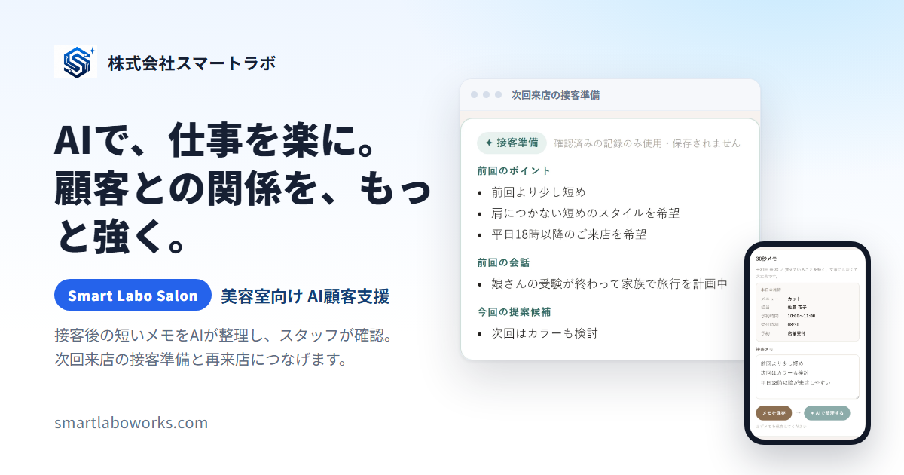

# Smart Labo ホームページ

株式会社スマートラボの会社ホームページ（https://smartlaboworks.com/ ）のソースです。
自社サービス（Smart Labo Works・Smart Labo Salon・Smart Labo Estate）とアプリ「カジまる」の紹介ページをまとめています。



---

## 主なページ

| ページ | 内容 |
|---|---|
| [トップ](https://smartlaboworks.com/) | 中小企業向け AI 業務支援サービス「Smart Labo Works」の紹介 |
| [Smart Labo Salon](https://smartlaboworks.com/salon.html) | 美容室・エステ・整体向けの AI 顧客支援と予約管理 |
| [Smart Labo Estate](https://smartlaboworks.com/estate.html) | 不動産営業の初回商談を支える営業支援システム |
| [AI 活用](https://smartlaboworks.com/ai-business.html) ／ [業務効率化](https://smartlaboworks.com/business-efficiency.html) ／ [社内ポータル](https://smartlaboworks.com/intranet.html) | 検索から来た人向けの解説ページ |
| [カジまる](https://smartlaboworks.com/kajimaru/) | 家事共有アプリの紹介と、Google Play 用のプライバシーポリシー |
| [会社情報](https://smartlaboworks.com/company.html) ／ [お問い合わせ](https://smartlaboworks.com/contact.html) | 会社概要と問い合わせフォーム |

---

## 技術と工夫

**ビルド不要のシンプルな構成**
- HTML / CSS / JavaScript だけで作り、フレームワークやビルドの手順は使っていません
- 外部ライブラリに頼らないので、表示が軽く、何年たっても壊れにくい作りです

**色や余白を一か所で管理**
- ブランドカラーや余白を CSS 変数（`assets/css/tokens.css`）にまとめ、どのページも同じ見た目になるようにしています

**JavaScript がなくても使える**
- お問い合わせフォームは、JavaScript が読み込まれなくても送信できます。JavaScript は、送信中の表示や入力チェックで使い心地を良くするためだけに使っています
- トップのスライダーも、JavaScript が止まったときは 1 枚目がそのまま表示されます

**見る人への配慮**
- スマホ・タブレット・パソコンのどれでも読みやすいレスポンシブデザイン
- 「動きを減らす」設定（`prefers-reduced-motion`）の人には、自動で切り替わる動きを止めます
- アクセス解析（Google Analytics）は、見る人が同意したときだけ動かします

**検索エンジン対策**
- `sitemap.xml`・`robots.txt`、SNS で共有したときの画像（OGP）、構造化データ（JSON-LD）を用意しています
- 画像の遅延読み込み（`loading="lazy"`）で、最初の表示を速くしています

---

## フォルダ構成

```
├── index.html              トップページ
├── salon.html / estate.html など   サービスごとのページ
├── kajimaru/               アプリ「カジまる」の紹介とプライバシーポリシー
├── assets/
│   ├── css/                tokens.css（色・余白）、base.css、components.css など
│   ├── js/                 main.js（メニュー・アニメーション）、contact-form.js など
│   ├── images/             画面写真・OGP 画像
│   └── brand/              ロゴ・アイコン
├── sitemap.xml / robots.txt
├── CNAME                   独自ドメイン（smartlaboworks.com）
└── .github/workflows/pages.yml   自動公開の設定
```

---

## 手元で見る方法

```bash
python -m http.server 8000
```

ブラウザで http://localhost:8000 を開きます。

---

## 公開の仕組み

`main` ブランチに push すると、GitHub Actions（`.github/workflows/pages.yml`）が動いて GitHub Pages に自動で公開されます。独自ドメイン `smartlaboworks.com` で配信しています。

お問い合わせフォームの送信先（PHP）は別のサーバーで動いていて、このリポジトリには含まれていません。

---

## 制作

企画・デザイン・実装・公開まで、AI（Claude Code・Codex）と一緒に一人で行っています。
